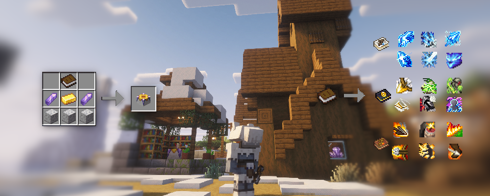

**How do you receive and cast the spells?**
* Spells from the spell book need the book equipped in the Trinket / Curios Mod's spell book slot.
* You need to have a weapon equipped, that can cast spells.
* To get a spell book, find or craft a Spell Binding Table.
* You can find a Spell Binding Table in villages with the [Gazebos](https://modrinth.com/mod/gazebos) Mod.
* Make sure to place 18 bookshelves around the Spell Binding Table.
*  Spell Scrolls with a single spell can be found in loot chests, they can be equipped or bound with lower XP- & Lapislazuli-cost on your spell book.
* Use bows, crossbows or other ranged weapons to cast the archery skills.

**What do the new Archers do?:**
* Three archery sub-classes for every ranged weapon enjoyer: Deadeye, Tundra Hunter and War Archer.
* Each one has its own spell book, armor sets and play-style.

##  Deadeye's List (Spell Book)

Rogue archers with fast ranged weapons and tricky skills.
* Strengths: Inflicting harmful effects and making sure not to be caught.
* Weaknesses: Heavily armored enemies.
* Equipment: Moderately armored.

<!-- SPELLS:deadeye -->
| Icon | Skill | ID | Description |
|---|---|---|---|
|  | Fast Shot | `archers_expansion:fast_shot` | Your next shots give you ranged haste. |
|  | Bouncing Arrow | `archers_expansion:bouncing_arrow` | An arrow that bounces from target to target. |
|  | Disabling Shot | `archers_expansion:disabling_shot` | Damages and slows the target and makes you jump back. |
|  | Choking Gas | `archers_expansion:choking_gas` | Creates a poisonous gas cloud where the arrow hits. |
|  | Venom Cask | `archers_expansion:venom_cask` | Throws a cask of venom that damages on impact and leaves a poisonous cloud. |
|  | Alter Ego | `archers_expansion:alter_ego` | Creates exploding decoys and makes you invisible. |
<!-- /SPELLS:deadeye -->

##  Tundric Hunting (Spell Book)

Tundra hunters with balanced ranged weapons and freezing projectiles.
* Strengths: Slowing and freezing enemies.
* Weaknesses: Heavily armored and CC immune targets.
* Equipment: Moderately armored.

<!-- SPELLS:tundra_hunter -->
| Icon | Skill | ID | Description |
|---|---|---|---|
|  | Frozen Shot | `archers_expansion:frozen_shot` | Your next shots stack Frosted on targets, slowing and finally freezing them. |
|  | Frozen Pact | `archers_expansion:frozen_pact` | Damages the target based on how frozen it is and reduces its attack. |
|  | Arctic Volley | `archers_expansion:arctic_volley` | Shoots a volley of arctic arrows that damage and frost targets. |
|  | Enchanted Crystal Arrow | `archers_expansion:enchanted_crystal_arrow` | Damages, stuns and freezes the target. |
|  | Polar Bearward | `archers_expansion:bearward` | Summons a Polar Bear that fights by your side, empowered by your ranged damage. |
|  | Frozen Fusillade | `archers_expansion:frozen_fusillade` | A barrage of ice around you that slows nearby enemies and speeds up allies. |
<!-- /SPELLS:tundra_hunter -->

##  War Archery Instructions (Spell Book)

War archers with fast, high damage ranged weapons, explosions and heavy damage.
* Strengths: High burst damage.
* Weaknesses: Fast and tricky enemies.
* Equipment: Heavily armored.

<!-- SPELLS:war_archer -->
| Icon | Skill | ID | Description |
|---|---|---|---|
|  | Dual Shot | `archers_expansion:dual_shot` | Fires two arrows at once. |
|  | Smoldering Arrow | `archers_expansion:smoldering_arrow` | Your next shot creates a small explosion that damages and burns nearby enemies. |
|  | Point-Blank Shot | `archers_expansion:point_blank_shot` | Damages and knocks back the target, stronger the closer it is. |
|  | Pin Down | `archers_expansion:pin_down` | Damages the target and stops it from moving or jumping. |
|  | Scorched Earth | `archers_expansion:scorched_earth` | Fires a bolt that sets a line of ground on fire. |
|  | Explosive Barrel | `archers_expansion:explosive_barrel` | Places a barrel that explodes when hit or approached by an enemy and sets enemies on fire. |
<!-- /SPELLS:war_archer -->
